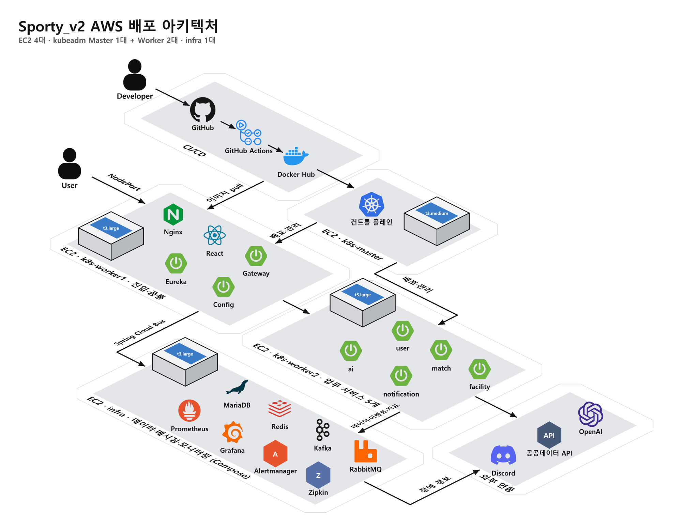

# Sporty v2 AWS 배포 아키텍처

기준: 팀이 전달한 「Sporty_v2 AWS 배포 아키텍처」 그림(2026-11-02). 이 문서는 **목표 배치 구조**를 설명한다. 그림에 등장하는 기술을 모두 AWS에 배포·검증했다는 뜻은 아니다. 구현 상태는 [백엔드 Kubernetes 초안](https://github.com/batontouch-sporty/backend/blob/main/k8s/README.md), [Compose 설정](https://github.com/batontouch-sporty/backend/blob/main/docker-compose.yml), 각 저장소의 CI 및 실제 배포 결과를 확인한다.

## 기존 시스템 구성도와의 관계

기존 [로컬 인프라 구성](infra-overview.md)은 React → Gateway → 다섯 업무 서비스와 데이터·관측 구성 요소의 **역할과 연결**을 보여준다. 이 그림은 같은 구성 요소를 **어떤 AWS EC2에 놓고, 이미지를 어떻게 전달하며, 사용자가 어디로 접속하는지** 보여주는 배포 관점이다. 두 문서는 서로 다른 범위를 설명한다.

## 그림에 표시된 목표 배치

| 위치 | 그림의 구성 | 역할 |
| --- | --- | --- |
| EC2 `k8s-master` (`t3.medium`) | kubeadm 컨트롤 플레인 | 클러스터 제어·배포 관리 |
| EC2 `k8s-worker1` (`t3.large`) | Nginx, React, Gateway, Eureka, Config | 사용자 진입점과 공통 서비스. 그림에는 이 노드의 장애가 서비스 진입에 영향을 준다고 표시됨 |
| EC2 `k8s-worker2` (`t3.large`) | user, match, facility, ai, notification | 다섯 업무 서비스. AI 서비스가 외부 OpenAI API와 연결되는 구조 |
| EC2 `infra` (`t3.large`) | MariaDB, Redis, Kafka, Prometheus, Grafana, Alertmanager, Zipkin, RabbitMQ | 데이터·메시징·메트릭·경보·추적 계층. 그림은 Docker Compose 운영을 제안 |
| 외부 | 공공데이터 API, OpenAI API, Discord | 시설 데이터, AI 호출, 운영 알림의 외부 연결 |

총 EC2 4대라는 숫자는 그림의 설계값이다. 실제 인스턴스 유형·노드 자원과 서비스 스케줄링은 AWS 및 Kubernetes 실행 결과로 확인해야 한다. Kubernetes에서 Pod는 매니페스트에 별도 배치 제약을 두지 않으면 그림처럼 노드에 고정되지 않는다.

## 요청·배포·관측 흐름

1. 사용자는 그림상 Worker1의 Nginx로 NodePort 경유 접속하고, React 화면의 API 요청은 Gateway를 거쳐 업무 서비스로 전달된다. **Nginx와 React, NodePort 연결은 그림의 목표 경로**이며 현재 저장소의 AWS 배포 확인 결과로 취급하지 않는다.
2. 개발자는 GitHub에 코드를 올리고 GitHub Actions가 Docker Hub 이미지를 만들며, Kubernetes 노드가 이미지를 pull해 배포하는 흐름을 그림이 제시한다. 현재 저장소의 CI 존재와 **Docker Hub 자동 배포 구성·실행 성공은 구분**한다.
3. 업무 서비스는 필요한 데이터·메시징 구성 요소를 사용한다. MariaDB는 한 서버에 서비스별 소유 DB 네 개(`user_db`, `match_db`, `facility_db`, `notification_db`)를 둔다. AI에는 별도 소유 DB가 없다. 다른 서비스의 DB를 직접 JOIN하거나 수정하는 계약은 이 그림으로 생기지 않는다. [DB 설계 R8](../data/schema-r8.md)을 따른다.
4. Prometheus는 서비스 지표를 수집하고 Grafana는 분석 화면을 제공한다. Alertmanager의 Discord 전송은 웹후크가 설정된 경우에만 가능하다. Zipkin은 추적용이다. 그림의 연결선은 각 지표·trace·경보가 실제 수집·전송되었다는 증거가 아니다.

## 저장소에서 확인되는 구현 범위

| 구성 | 확인된 기준 | 그림과의 차이 |
| --- | --- | --- |
| 로컬 Compose | [backend/docker-compose.yml](https://github.com/batontouch-sporty/backend/blob/main/docker-compose.yml)에 업무 서비스·MariaDB·Redis·Kafka·Zipkin·Prometheus·Grafana·Alertmanager 정의 | 로컬 단일 Compose 구성이다. AWS `infra` EC2에서 실행한 결과는 별도 확인 필요 |
| Kubernetes | [backend/k8s/README.md](https://github.com/batontouch-sporty/backend/blob/main/k8s/README.md)에 `sporty` 네임스페이스, Discovery·Zipkin 매니페스트와 공통 설정 초안 기록 | Gateway·다섯 업무 서비스·Config·React/Nginx, 데이터 계층의 전체 K8s 배포는 아직 해당 디렉터리에 구현되지 않음 |
| CI/CD | [backend 워크플로](https://github.com/batontouch-sporty/backend/tree/main/.github/workflows)와 [frontend 워크플로](https://github.com/batontouch-sporty/frontend/tree/main/.github/workflows)의 CI·PR 검사 | 그림의 Docker Hub push, 이미지 pull, Kubernetes 자동 배포 파이프라인은 이 확인만으로 입증되지 않음 |
| RabbitMQ | 업로드된 그림의 `infra` 노드 | 현재 백엔드 Compose에 정의되지 않음. Kafka 사용과 별개로 RabbitMQ 도입 목적·구성·담당을 확정해야 함 |

## 실제 배포 전에 확정·검증할 내용

- **접속 경계:** NodePort·Nginx·Gateway의 실제 노출 포트, 보안 그룹, 도메인·TLS, 브라우저 API 주소와 CORS를 확인한다.
- **노드 배치:** 목표대로 Worker1/Worker2에 배치하려면 노드 라벨, node affinity 등 매니페스트의 배치 조건과 장애 시 동작을 정한다. 단일 컨트롤 플레인·단일 진입 노드·단일 infra 노드의 장애 범위도 검증한다.
- **데이터 운영:** `infra` EC2의 MariaDB 데이터와 Kafka·관측 데이터의 볼륨, 백업·복구 및 재기동 절차를 정한다. 로컬 Compose 설정을 그대로 운영 배포의 지속성 보장으로 간주하지 않는다.
- **이미지와 비밀값:** 레지스트리, 불변 이미지 태그, pull 인증과 DB·JWT·외부 API 키·Discord 웹후크의 주입 방식을 배포 환경에 맞춰 정한다.
- **증빙:** 실제 EC2 4대·Kubernetes 노드/Pod Ready, 접속·API 호출, 이미지 배포, 서비스별 지표·trace·경보·외부 API 연결을 각각 실행 결과로 확인한다.

그림은 팀 설계 자료이며, 위 표는 확인 시점의 저장소 `main`을 기준으로 작성했다. 이후 매니페스트와 워크플로가 변경되면 이 문서의 구현 상태도 다시 대조한다.
