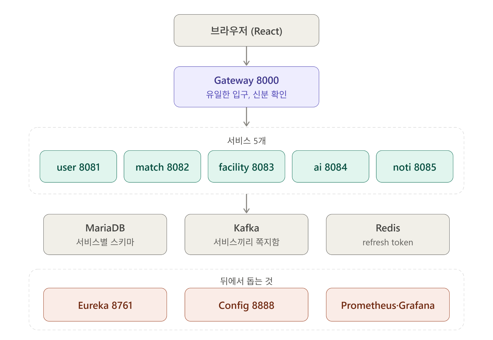

# Sporty v2 로컬 인프라 구성

기준: 전달된 인프라 구조도(2026-11-01)와 [백엔드 Compose](https://github.com/batontouch-sporty/backend/blob/main/docker-compose.yml), [모니터링 설정](https://github.com/batontouch-sporty/backend/blob/main/monitoring/README.md). 그림은 **구성 개요**이며 서비스 간의 모든 호출, Kafka 토픽, 배포 환경의 네트워크 구획을 나타내지 않습니다. 포트와 수집 대상은 실행 시점의 설정을 우선합니다.

## 요청과 업무 서비스

브라우저의 React 앱은 Gateway(8000)를 통해 백엔드 API에 접근합니다. Gateway가 라우팅과 JWT 인증·권한 확인을 담당하고, Eureka로 등록된 업무 서비스를 찾습니다. 아래 서비스 포트는 **컨테이너 내부 포트**입니다. 현재 Compose에서 호스트에 게시되는 앱 포트는 Gateway의 `127.0.0.1:8000`뿐이며, 다른 업무 서비스 포트는 호스트에 게시하지 않습니다.

| 구성 요소 | 내부 포트 | 역할 |
| --- | ---: | --- |
| gateway-service | 8000 | 외부 API 진입점, 서비스 라우팅, 인증·권한 검사 |
| user-service | 8081 | 회원·인증·프로필, 탈퇴 Saga |
| match-service | 8082 | 매치·참가·대기열 |
| facility-service | 8083 | 공공체육시설 조회·동기화 |
| ai-service | 8084 | AI 검색·초안·추천 |
| notification-service | 8085 | 이벤트 기반 사용자 알림 |

## 공통 인프라와 데이터 경계

| 구성 요소 | 역할과 경계 |
| --- | --- |
| MariaDB | 서버 1대 안에 `user_db`, `match_db`, `facility_db`, `notification_db` 네 서비스 소유 DB. AI의 소유 DB는 없음. 서비스 간 ID는 논리 참조하며 교차 DB FK·직접 JOIN을 사용하지 않음. [R8 DB 설계](../data/schema-r8.md) 참고 |
| Kafka | 서비스 사이 이벤트 전달. 그림의 화살표는 모든 서비스가 모든 토픽을 발행·구독한다는 의미가 아님 |
| Redis | 회원 인증의 refresh token 저장 |
| discovery-service (Eureka) | 내부 포트 8761, 서비스 등록·발견 |
| config-service | 내부 포트 8888, [config-repo](https://github.com/batontouch-sporty/config-repo)의 설정 제공 |

## 관측과 운영

그림의 `Prometheus·Grafana`는 관측 계층의 요약입니다. **현재 백엔드 Compose에는 Alertmanager와 Zipkin도 있습니다.**

| 구성 요소 | 현재 로컬 구성 |
| --- | --- |
| Prometheus | 자체 지표와 Gateway 및 업무 서비스 5개의 `/actuator/prometheus` 수집. Gateway Actuator는 내부 관리 포트 8001 사용. Eureka·Config는 현재 수집 대상이 아님 |
| Grafana | Prometheus 지표 분석 화면. 로컬 호스트 기본 포트 3001 |
| Alertmanager | Prometheus 경보 처리. Discord 웹후크는 설정된 경우에만 전송. 로컬 호스트 기본 포트 9093 |
| Zipkin | 분산 추적용 서비스. 로컬 호스트 기본 포트 9411. 실행 환경 제공과 실제 trace 연동·검증은 별개 |

Prometheus의 호스트 기본 포트는 9090입니다. Gateway는 ADMIN JWT의 `GET /prometheus/api/v1/query`와 `GET /prometheus/api/v1/query_range`만 중계합니다. 각 구성 요소의 호스트 포트와 실행 여부는 Compose의 `.env` 및 `docker compose ps`로 확인해야 합니다. Prometheus·Grafana·Alertmanager·Zipkin과 MariaDB·Redis·Kafka의 호스트 포트는 개발 편의를 위해 `127.0.0.1`에 바인딩되며, 운영 배포의 공개 주소를 뜻하지 않습니다.

그림과 이 문서는 **구성 설정을 설명**합니다. 서비스의 실제 `UP`, 지표 수집 성공, Kafka 이벤트 전달과 브라우저 대시보드의 종단 간 동작은 실행 결과로 별도 검증해야 합니다.
