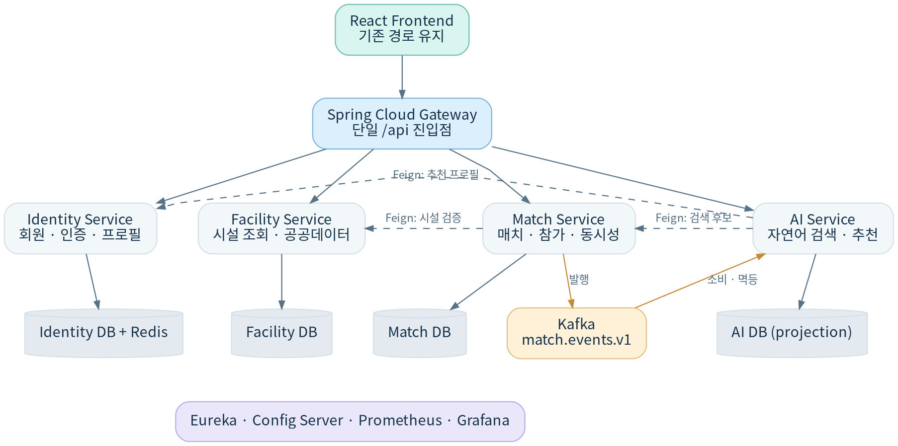

# Sporty v2 수행계획서

> 출처: `Sporty_MSA_2조_프로젝트_수행계획서(1).docx` · v0.1 · 팀 합의 전 설계 초안. 1차 코드 정적 확인은 2차 구현·실행 검증을 뜻하지 않습니다.
> **최신 결정:** [고도화 범위와 문서 차이](../decisions/2026-10-30-scope-update.md)를 먼저 확인하세요. 이 변환본은 원본 보존을 위해 4개 서비스와 기존 이벤트 설계를 그대로 담습니다.

MINI PROJECT 02  ·  ENGINEERING PACKAGE

Sporty 1차 → MSA 2차 전환 계획 · 아키텍처, 범위, 일정, 역할, 평가 대응

| 프로젝트 | Sporty MSA — AI 기반 생활체육 매칭 플랫폼 |
| --- | --- |
| 팀/기간 | LG CNS AM Inspire Camp 6기 · 미니프로젝트 2 · 2조 (8명) 2026.10.30(금) ~ 11.05(목), 주말 제외 5일/40시간 |
| 버전/상태 | v0.1  ·  팀 합의 전 설계 초안 |
| 근거 | 1차 산출물 + GitHub main 02533ba6ca + 2차 공식 안내 |

판독 기준  1차에서 존재한 기능과 2차에 새로 구현할 MSA 기능을 구분합니다. 기존 코드에 대한 정적 확인은 런타임 테스트 통과를 의미하지 않습니다.

## 01. 프로젝트 목적 및 범위

기존 Sporty는 서울시 공공체육시설 목록과 생활체육 매칭을 연결하고, 자연어로 매치를 검색·생성하도록 돕는 플랫폼이다. 미니프로젝트 2에서는 기존 사용자 기능을 보존하면서 독립 서비스, 동기/비동기 통신, 배포·관측을 구현한다.

| 항목 | 1차 기준 | 2차 목표 |
| --- | --- | --- |
| 구조 | React + Spring Boot 단일 백엔드 + MariaDB/Redis | React + Gateway + 4개 도메인 서비스 + Eureka/Config |
| 데이터 | 단일 DB에서 JPA 연관관계 사용 | Database per Service, 외부 도메인 ID는 참조값만 유지 |
| 연계 | 내부 서비스/Repository 직접 호출 | OpenFeign(조회), Kafka(이벤트 동기화) |
| 배포 | 로컬 실행·기존 CI 일부 | 서비스별 Dockerfile, Compose 통합; 선택 K8s |
| 차별화 | AI 자연어 매칭 | MSA 지표 모니터링을 10번 핵심 기술로 제안 |

## 02. MVP와 제외 범위

- MVP 유지: 회원가입/로그인/토큰·프로필, 시설 검색/상세, 매치 생성·검색·참여·탈퇴, AI 자연어 검색·생성 초안·추천.
- MSA 필수: 4개 서비스 분리, Discovery/Gateway/Config, Feign/Kafka, 서비스별 DB, Compose, 모니터링.
- 선택(시간 여유): 공식 선택 3점 후보는 Circuit Breaker, Kubernetes, 부하 테스트, CI/CD. Outbox는 별도 비배점 내부 개선안.
- 제외: 실제 체육시설 예약 확정/결제, 실사용 다중 클라우드 운영, 신규 파티/번개 할인 등 1차 제외 기능.

## 03. 제안 시스템 아키텍처

> 실선 = 외부/DB/이벤트 경로, 점선 = Feign 동기 호출. 위 그림은 구현 완료도가 아닌 제안 경계이며, 실제 서비스 분리 전 API·데이터 소유권 계약을 먼저 합의한다.

| 서비스 | 책임 / 기존 DB | 내부 통신 |
| --- | --- | --- |
| identity-service | 회원·인증, 프로필, 선호 종목 DB: user / profile / sport_preference | GET /internal/users/{userId}/recommendation-profile |
| facility-service | 공공 체육시설 수집·검색·상세, 로컬 캐시 DB: location / service | GET /internal/services/{serviceId}/validation |
| match-service | 매치 CRUD, 참여·탈퇴, 정원·상태·이벤트 DB: match / match_participant / outbox_event(제안) | GET /internal/matches |
| ai-service | 자연어 검색·생성 초안·맞춤 추천, 추천 조회 모델 DB: match_projection / processed_event(제안) | /api/ai/matches* |

## 04. 핵심 업무 흐름

| 흐름 | 단계 | 검증 기준 |
| --- | --- | --- |
| 매치 생성 | React → Gateway → Match → Feign Facility 검증 → Match DB 트랜잭션 → Kafka MatchCreated → AI projection | 존재하는 시설만 생성, 개설자 OWNER 생성, Consumer 멱등 |
| AI 검색 | React → Gateway → AI 자연어 해석 → Feign Match 조건 검색 → 결과/조건 요약 | 매치 추천 후보는 서버 필터링, AI 결과는 재검증 |
| 회원 맞춤 추천 | AI → Feign Identity 프로필 최소 조회 → AI projection 후보 → 최종 조회 검증 | 선호 종목·자치구·성별 필터; 3건 이하 |
| 탈퇴·장애 | Identity WITHDRAWN → UserWithdrawn(후속 이벤트) → Match 참여 정리; Facility 장애는 기존 캐시 조회 | 중복 처리 및 이벤트 지연 시나리오 문서화 |

## 05. 팀 구성과 역할 배분(초안)

참여 팀원: 안지산, 나유성, 박선아, 서우영, 손호성, 이상혁, 진성민, 최환우. 담당 역할은 아직 확정되지 않아 개인별 배정을 임의로 정하지 않았다.

| 구분 | 제안 인원 | 주요 책임 | 결과물 |
| --- | --- | --- | --- |
| 기획 / PM | 1 | 요구사항, 공통 계약, 일정/이슈 조율 | 수행계획서·WBS·최종 리뷰 |
| BE | 3 | Identity/Facility/Match/AI 서비스 분리, Feign/Kafka, DB 분리 | API 명세·ERD·서비스 테스트 |
| FE | 2 | 기존 React Gateway 연동, 인증·오류·로딩·시연 흐름 | 화면 연결 및 E2E |
| Infra | 1 | Eureka/Gateway/Config/Compose/모니터링, 선택 K8s | 배포 구성·운영 대시보드 |
| QA·문서 | 1 | TC 수행, 결함·증빙, 발표자료·산출물 검수 | 테스트 결과·결과보고서 |

## 06. 5일 일정과 게이트

| 일자 | 핵심 활동 | 완료 Gate |
| --- | --- | --- |
| 10/30 금 · Day 1 | 1차 코드/데이터 기준 고정, 도메인 경계·DB/Feign/Event 계약, WBS·역할 확정 | 분리 아키텍처·요구/API/테이블 v0.1 승인 |
| 11/02 월 · Day 2 | Eureka·Config·Gateway 및 4개 서비스 기본 골격, DB 생성, 인증·시설·매치 이관 | 4개 Health UP, 경유 API 1개 이상 |
| 11/03 화 · Day 3 | Feign 검증/검색, Kafka 발행·소비, AI 연결, FE Gateway 단일 주소 전환 | 매치 생성→이벤트→AI projection 통합 검증 |
| 11/04 수 · Day 4 | 핵심 모니터링, Compose 완성, 회귀/동시성/장애 테스트, 선택 항목 | E2E·중복 이벤트·정원 경쟁 통과 |
| 11/05 목 · Day 5 | K8s 가능 여부 판단, 최종 배포·증빙·발표 10분 시연, 문서 갱신 | 필수 1~10 증빙, 7종 산출물, 발표 |

## 07. 평가 대응 및 우선순위

공식 평가: 핵심 요구 10개×7점=70점, 선택 요구 10개×3점=30점, 정성(산출물 ±10, 아키텍처 ±5, 시연 ±5). 기능 100점을 기본으로 정성평가가 적용된다.

| 우선 | 목표 | 시연/증빙 |
| --- | --- | --- |
| P0 필수 | MSA-01~10 모두 구현·검증 | 서비스 구성/ERD, Eureka, Gateway, Config, Feign, Kafka, Compose, Grafana |
| P1 안정화 | 기존 UI/API 회귀 + 분산 정합성 | 매치 생성·동시 참가 1자리·오류/재처리 테스트 |
| P2 선택 | K8s·Circuit Breaker·부하 테스트·CI/CD 중 실행 가능한 3점 항목 | 완료 증빙이 있는 선택 항목만 점수 예상 |

## 08. 주요 리스크와 대응

| 리스크 | 영향 | 우선 대응 |
| --- | --- | --- |
| JPA 관계가 다른 서비스 테이블 참조 | 서비스별 DB 분리 시 기동 실패·정합성 오류 | 외부 FK 제거, 단순 식별자·DTO/스냅샷으로 변경 |
| 공공 API 키/수집 불안정 | 시설 조회/시연 실패 | 기존 적재 데이터/시드로 통합 Gate 수행 |
| AI 응답 지연·비결정성 | E2E 부정합 | Mock 테스트와 실 AI 품질 검증을 분리, 서버 필터·대체 정렬 |
| Kafka 발행/소비 장애 | 추천 조회 모델 최신성 지연 | eventId·version, 처리 이력, 재시도/로그; Outbox는 P2 |
| 5일 일정과 인프라 자원 | 완성/문서 작업 부족 | Day 2에 전체 골격 연결, Day 4 P0 freeze 후 P2 판단 |

## 09. 제출 산출물 및 관리 원칙

- 필수 제출: 수행계획서, 요구사항 명세서, WBS, ERD/테이블 명세서, 테스트 케이스, 결과보고서, 기타 관련 자료(서비스별 GitHub/화면/시연영상).
- API 명세는 요구사항·테스트·서비스 구현 기준으로 함께 관리하며 기존 엔드포인트 호환을 우선한다.
- 변경 이력은 D-01~D-10 결정 기록에 반영하고, 팀 합의가 나기 전 제안 항목을 구현 완료로 표기하지 않는다.
- 테스트 시트의 초기 상태는 전부 Not Run이다. 실행 일자·환경·증빙이 있을 때만 Pass로 변경한다.

## 참고 자료 / 기준

1차 요구사항·테스트  2조_요구사항_명세서(1).pdf / 2조_테스트_케이스.pdf

1차 DB·화면  2조_테이블_명세서.xlsx / 2조_ERD.png / 2조_화면설계도(1).pdf

1차 수행·발표  2조_프로젝트_수행계획서.pdf / 2조_발표자료.pptx / 2조_WBS.xlsm

공식 2차 지침  [CNS 6기]_미니PJT2 수강생 안내.pdf

구현 기준  https://github.com/livelykitten/inspire_6th_mini_1_sporty  @ 02533ba6ca253e2cbb6beb75c2f78fdf68a7ba8c

Spring Cloud 호환  https://spring.io/projects/spring-cloud/ (Boot 3.5.x ↔ Cloud 2025.0.x)
